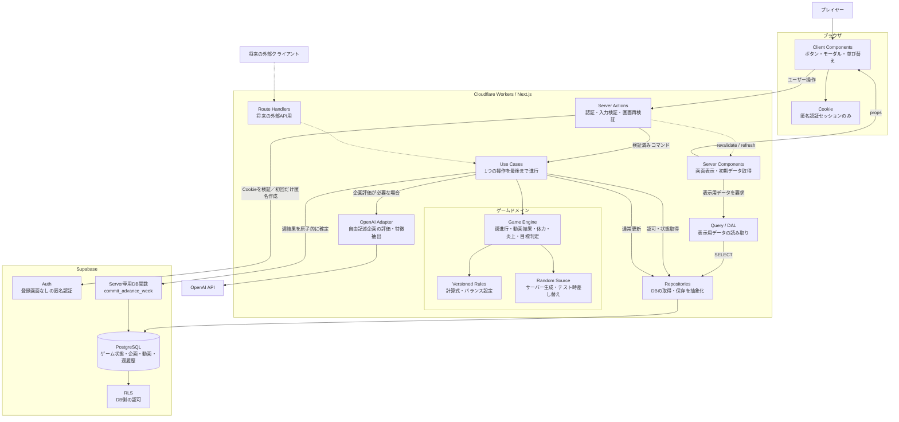
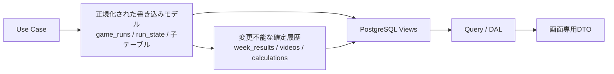

# 『YouTuberになろう！（仮）』アーキテクチャ図

> ステータス：非UI実装着手版  
> 更新日：2026年10月27日

関連資料：`USE_CASES.md`（操作単位の処理）、`DATABASE_DESIGN.md`（テーブル・制約）、`DATABASE_ERD.svg` / `DATABASE_ERD.png`（実行時ER図）、`RULES_ERD.svg` / `RULES_ERD.png`（ルールER図）。ゲームルールの正本は `docs/ゆーちゅーばーになろう（仮）_ゲーム仕様書.md` とする。



## 主要な責務

| 要素 | 責務 |
|---|---|
| Server Components | 表示用のデータを読み取り、画面を組み立てる |
| Client Components | クリック、入力、モーダル、並び替えなどブラウザ上の操作を担当する |
| Server Actions | 認証、入力検証を行い、ユースケース関数を呼び出す |
| Use Cases | 「次週へ進む」など1つの目的に必要な処理全体を進行する |
| Game Engine | DBや画面から独立したTypeScript関数としてゲーム結果を計算する |
| Query / DAL | 正規化されたテーブルをViewまたはQueryで結合し、必要最小限の表示用DTOを返す |
| Repositories | `GameRun`、`IdeaStock`、`WeekResult` など集約単位で取得・保存処理を隠蔽する |
| RLS | 他ユーザーのゲームデータへアクセスできないようDB側でも認可する |

ユーザー登録画面は設けない。「始める」押下時にSupabase匿名認証を自動実行し、Cookieへセッションだけを保存する。ゲーム本体はDBへ保存し、`auth.users.id`と`game_runs.user_id`で所有権を判定する。同一ブラウザでは再開できるが、Cookie削除・別端末からの復旧は初期版では扱わない。

ゲーム開始画面はアクティブなルールセットからチャンネル種類と専門分野マスタを読み取る。特化系を選択した場合だけ10分野の選択を必須にし、`startGame`がチャンネル種類と専門分野の組み合わせを検証して`game_runs`へ固定する。他の3種類では専門分野を保存しない。特化系のゲーム側企画は、クライアント入力ではなく保存済みの専門分野を基準に絞り込む。

## `advanceWeek` の処理境界

```mermaid
flowchart LR
    Start[次週に進む] --> Load[状態・目標・企画・行動を取得]
    Load --> Unavailable{活動不能中か}
    Unavailable -->|はい| Skip[復帰まで1週進める]
    Unavailable -->|いいえ| Action[メイン行動を適用<br/>休憩は先に回復]
    Action --> Select[投稿本数分の企画を選択]
    Select --> Fill{ストックは足りるか}
    Fill -->|不足| Auto[種類別または専門分野別50企画から<br/>重複なしで補充]
    Fill -->|足りる| Videos[基礎再生数×7倍率]
    Auto --> Videos
    Videos --> ViewEvent[週間再生イベント補正]
    ViewEvent --> Growth[登録者増加・広告収益]
    Growth --> Unlock[広告・コラボ・企業案件<br/>週内到達で永続解放]
    Unlock --> Energy[投稿体力を消費]
    Energy --> Flame[週1回の炎上判定<br/>登録者=floor(現在値×0.95)・体力-20]
    Flame --> Fatal{炎上3回または体力0か}
    Fatal -->|いいえ| Health[共通の体調不良を判定]
    Fatal -->|はい| GameOver[通常週結果を破棄<br/>終了記録だけ保存]
    Health --> Points[体調不良は翌週から<br/>能力ポイントを付与]
    Points --> Goals[ステージ目標・期限を判定]
    Skip --> Commit[週結果を一括保存]
    GameOver --> TerminalCommit[game_terminationsを保存]
    Goals --> Commit
    Commit --> Result[週間結果を表示]
    TerminalCommit --> Result
```

ゲーム計算はNext.js上のTypeScriptで行い、通常週の複数テーブル更新はServer専用PostgreSQL関数`commit_advance_week`で1トランザクションにする。死亡・BANでは通常週結果を適用せず終了記録だけを確定し、期限切れでは最終週を通常確定してから終了記録を残す。二重実行は`idempotency_key`、`state_version`、`UNIQUE (run_id, week_number)`の3層で防止する。

## 書き込みモデルと読み取りモデル



- 能力、機材、機能解放、企画キューは種類ごとの列やJSONBではなく子テーブルへ正規化する。
- 画面向けの横持ち形式は `current_game_view` などのViewまたはDTOで作り、更新対象にしない。
- 数値ルールは公開後変更不能な `rule_sets` と型付きルールテーブルへ保存する。
- `week_results` と `video_calculations` の重複値は、過去結果を説明するための意図的な確定スナップショットとする。

## 現時点の方針

- UI専用の更新操作はServer Actionsから呼び出す。
- Server ComponentsはServer Actionsを経由せず、Query / DALから表示データを取得する。
- REST APIが必要になった場合は、Route Handlersから同じUse Caseを呼び出す。
- OpenAIの出力をゲーム結果の正本にせず、構造化された企画評価としてゲームエンジンへ渡す。
- 再生数・登録者数・体力・炎上などの最終結果はサーバー側のゲームエンジンが決定する。
- 乱数はサーバー側で生成し、生の乱数値は保存せず、基礎再生数や発生イベントなどの確定結果だけを保存する。
- ゲーム側企画はプレイヤーが追加するものではなく、`advanceWeek` が企画不足分だけ自動選出する。
- 特化系は開始時に10専門分野から1つを必須選択し、その人生では変更しない。ゲーム側企画は選択専門分野の50件だけを使用する。
- 週のメイン行動は1つだけ保存し、投稿・企画作成・能力配分・機材購入とは分けて扱う。
- 週間ランダムイベント（良い5%・悪い5%）と炎上は独立に週1回ずつ判定する。炎上率は炎上系5.0%、その他0.1%で、投稿本数には依存しない。
- 初期版ではSupabase Edge Functionsを使わず、週進行の計算はNext.js、原子的保存はPostgreSQL関数に分担する。
- 匿名セッションを扱うゲーム画面は静的生成せず、Cookieをリクエスト単位で読む動的レンダリングにする。
