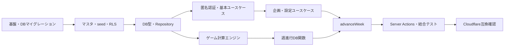

# バックエンド実装チケット

> 目的：UIに依存せず、匿名ユーザーがゲームを開始・保存・週進行・再開・終了できるバックエンドを完成させる。  
> 正本仕様：`docs/ゆーちゅーばーになろう（仮）_ゲーム仕様書.md`  
> 設計資料：`ARCHITECTURE.md`、`DATABASE_DESIGN.md`、`USE_CASES.md`

## 1. 対象範囲

含むもの：

- Supabase PostgreSQLのマイグレーション、制約、RLS、View、Server専用DB関数
- 静的マスタ、バージョン付きルール、ゲーム側企画650件の冪等seed
- Supabase匿名認証とCookieセッション
- Repository / Query / DTO
- 全更新系ユースケースとServer Actions
- OpenAI企画評価
- 副作用のないゲーム計算エンジン
- `advanceWeek`の冪等・排他的・原子的な確定
- 自動テスト、Cloudflare向けビルド確認

含まないもの：

- 画面レイアウト、コンポーネント、アニメーション、デザインシステム
- サムネイルやゲーム画像
- アカウント連携、端末移行、コラボ相手選択、治療など初期版対象外機能
- 本番デプロイの実行（ビルドとデプロイ手順の確認までは含む）

## 2. チケットの粒度

| サイズ | 目安 | 方針 |
|---|---:|---|
| S | 半日程度 | 単一設定、単一Query、小さなユースケース |
| M | 1〜2日 | 1つのスキーマ領域、1〜2ユースケース |
| L | 2〜3日 | 複雑なDB関数、週進行など。これ以上は分割する |

原則として、各チケットを1PRで完了できる大きさにする。テストは後回しにせず、各チケットの受け入れ条件へ含める。

## 3. 完了条件

次をすべて満たした時点で「バックエンド完了」とする。

- 新しいブラウザセッションから、登録画面なしで匿名ユーザーを作成できる
- 4チャンネル種類からゲームを開始でき、特化系だけ10専門分野の選択が必須になる
- ゲームを保存・再開・中断・改名できる
- 企画作成、AI評価、削除、並び替え、投稿頻度、能力、機材、週間行動を操作できる
- 通常週、活動不能週、死亡、炎上BAN、期限切れ、ステージクリアを仕様どおり確定できる
- 同一週の二重実行と同一リクエスト再送でデータが重複しない
- 別ユーザーのゲームへアクセスできない
- 650件のゲーム側企画がDBに入り、対象プールごとに50件ずつ検証される
- lint、型チェック、単体テスト、DBテスト、結合テスト、Next.jsビルド、Cloudflare向けビルドが通る

## 4. 全体の依存関係

---

## Phase 0：着手準備

### BE-000 専門企画ブランチをmainへ統合する

- 優先度：P0
- サイズ：S
- 依存：なし

作業：

- `codex/specialized-system-ideas`をレビューして`main`へ統合する
- `npm run system-ideas:validate`、lint、型チェック、通常ビルドを再確認する
- 作業開始時点のベースコミットを確定する

受け入れ条件：

- `main`に650件のJSON、Schema、検証スクリプト、最新設計資料が存在する
- 作業ツリーがクリーンで、`origin/main`と同期している

### BE-001 バックエンドのテスト・ディレクトリ規約を用意する

- 優先度：P0
- サイズ：M
- 依存：BE-000

作業：

- `domain`、`application`、`infrastructure`、`queries`、`actions`の配置規約を決める
- TypeScript単体テスト環境を追加する
- DBテストと結合テストの実行コマンドを追加する
- Server専用モジュールがクライアントへ混入しない境界を定める

受け入れ条件：

- サンプル単体テストとテストコマンドが成功する
- テスト用環境変数と本番秘密情報が分離されている
- READMEに実行方法が記載されている

---

## Phase 1：SupabaseとDBスキーマ

### BE-002 Supabaseローカル開発とマイグレーション基盤を用意する

- 優先度：P0
- サイズ：M
- 依存：BE-000

作業：

- Supabase CLIのプロジェクト構成を追加する
- 番号付きSQLマイグレーション、seed、DBテストの配置を決める
- 必要なPostgreSQL拡張とUUID生成方法を定義する
- ローカルDBの初期化・再構築コマンドをREADMEへ追加する

受け入れ条件：

- 空のローカルDBへ全マイグレーションを適用できる
- DBをリセットして同じ状態を再現できる
- Dashboardの手作業を前提にしない

### BE-003 静的カタログとrule_setsを作成する

- 優先度：P0
- サイズ：M
- 依存：BE-002

対象：

- `channel_types`
- `specialty_categories`
- `ability_definitions`
- `equipment_types`
- `action_definitions`
- `feature_definitions`
- `event_categories`
- `event_definitions`
- `rule_sets`

受け入れ条件：

- PK、UNIQUE、NOT NULL、表示順の制約がある
- 10専門分野を自由文字列ではなくFK参照できる
- 公開済みルールセットを更新・削除できない方針がテストされる

### BE-004 バージョン付きルールテーブルを作成する

- 優先度：P0
- サイズ：L
- 依存：BE-003

対象：

- `global_rules`
- `channel_rules`
- `channel_ability_weights`
- `rule_set_specialties`
- `posting_frequency_rules`
- `idea_score_band_rules`
- `equipment_tier_rules`
- `action_rules`
- `sponsorship_reward_rules`
- `feature_rules`
- `goal_rules`
- `event_category_rules`
- `event_rules`
- `health_risk_rules`

受け入れ条件：

- 数値は型付き列で保持し、ルール正本に巨大なJSONBを使わない
- 範囲重複、負数、確率、倍率、能力重み合計などを制約または公開時検証で拒否できる
- すべてのルール行を`rule_sets`へ追跡できる

### BE-005 ゲーム人生と現在状態テーブルを作成する

- 優先度：P0
- サイズ：L
- 依存：BE-004

対象：

- `profiles`
- `game_runs`
- `run_state`
- `run_abilities`
- `run_equipment`
- `run_feature_unlocks`
- `run_conditions`
- `run_goals`

受け入れ条件：

- 1匿名ユーザーにつき進行中ゲームは最大1件
- 特化系だけ`specialty_code`が必須で、他種類ではNULL
- チャンネル種類、専門分野、ルールセットは開始後変更できない
- 初期状態を1トランザクションで作成できる

### BE-006 プレイヤー入力・設定・購入履歴テーブルを作成する

- 優先度：P0
- サイズ：L
- 依存：BE-005

対象：

- `player_ideas`
- `idea_evaluations`
- `idea_queue_entries`
- `weekly_actions`
- `ability_point_grants`
- `ability_allocations`
- `equipment_purchases`

受け入れ条件：

- 企画原本、キュー、評価、消費状態を重複列で表現しない
- キュー位置と週間行動がゲーム・週単位で一意
- 能力配分と購入履歴が変更不能な事実として残る

### BE-007 システム企画とサイクルテーブルを作成する

- 優先度：P0
- サイズ：M
- 依存：BE-004、BE-005

対象：

- `system_idea_templates`
- `rule_set_system_ideas`
- `system_idea_cycles`
- `system_idea_cycle_entries`

受け入れ条件：

- 特化系テンプレートだけ専門分野必須、他種類ではNULL
- 1サイクル内で企画と位置がそれぞれ一意
- 使用済みフラグを重複保存せず、動画参照から導出できる
- 各ゲーム人生の選択プール以外をサイクルへ混入できない

### BE-008 週結果・動画・イベント・終了履歴を作成する

- 優先度：P0
- サイズ：L
- 依存：BE-005、BE-006、BE-007

対象：

- `advance_week_executions`
- `week_results`
- `videos`
- `video_calculations`
- `occurred_events`
- `game_terminations`

受け入れ条件：

- `idempotency_key`と`(run_id, week_number)`が一意
- 動画はプレイヤー企画またはシステム企画の片方だけを参照する
- 計算倍率と最終結果を確定時スナップショットとして保存する
- 死亡・BAN、期限切れ、中断の保存形式を区別できる

### BE-009 DB不変条件・公開時検証・履歴の変更禁止を実装する

- 優先度：P0
- サイズ：L
- 依存：BE-003〜BE-008

作業：

- 複合FK、CHECK、排他制約、部分一意インデックスを実装する
- ルールセットと参照ルール行の版一致を保証する
- 公開済みルールと確定履歴のUPDATE / DELETEを拒否する
- ルールセット公開前に、点数帯、確率、能力重み、企画数を検証する

受け入れ条件：

- 不正な組み合わせをアプリ経由だけでなくSQL直実行でも拒否する
- 初期ルールセットは公開可能で、不完全なテスト用ルールセットは公開を拒否される
- 制約ごとのDBテストがある

### BE-010 RLSとDB関数の権限を実装する

- 優先度：P0
- サイズ：L
- 依存：BE-005〜BE-009

作業：

- 全ユーザーデータテーブルでRLSを有効化する
- `game_runs.user_id = auth.uid()`を所有権の起点にする
- 子テーブルは所有するゲーム人生まで`EXISTS`で辿る
- 静的マスタと公開ルールを読み取り専用にする
- Server専用DB関数から`PUBLIC`、`anon`、`authenticated`の直接実行権限を剥奪する

受け入れ条件：

- ユーザーAがユーザーBの行をSELECT / INSERT / UPDATE / DELETEできない
- 未認証`anon`はゲームデータを読めない
- AI評価点をクライアント用Queryから取得できない
- RLS回帰テストがある

### BE-011 静的マスタ・ルール・650企画の冪等seedを作成する

- 優先度：P0
- サイズ：L
- 依存：BE-003、BE-004、BE-007、BE-009

作業：

- 仕様書の確定値を初期`rule_set`へ投入する
- `data/system-ideas`のJSONを検証して`system_idea_templates`へ投入する
- `rule_set_system_ideas`と10専門分野を関連付ける
- 自然キーを使い、同じseedを複数回実行しても重複させない

受け入れ条件：

- 2回連続実行して件数と内容が変わらない
- 王道・炎上・アイドル各50件、特化系各分野50件、全650件になる
- JSONをゲーム実行時に直接参照しない
- seed後に初期ルールセットの公開時検証が通る

### BE-012 読み取りViewとDB生成型を作成する

- 優先度：P0
- サイズ：M
- 依存：BE-005〜BE-011

対象View：

- `current_game_view`
- `idea_stock_view`
- `week_history_view`
- `video_result_view`

受け入れ条件：

- Viewは`security_invoker = true`
- 現在状態にチャンネル種類と専門分野名を含められる
- SupabaseのDB型をTypeScriptへ生成できる
- 手書きDB Row型を重複管理しない

---

## Phase 2：アプリケーション基盤と匿名認証

### BE-013 Repository・トランザクション・時計・乱数の境界を作成する

- 優先度：P0
- サイズ：L
- 依存：BE-012、BE-001

作業：

- `GameRunRepository`、`IdeaStockRepository`、`RuleRepository`、`WeekResultRepository`を定義する
- DB Rowをドメインモデルへ変換するMapperを分離する
- `Clock`と`RandomSource`をインターフェース化する
- テスト用インメモリまたは固定値実装を用意する

受け入れ条件：

- ドメイン計算からSupabase SDKを直接呼ばない
- 乱数と現在時刻をテストで固定できる
- Repositoryの結合テストがある

### BE-014 Supabase匿名認証とCookieセッション更新を実装する

- 優先度：P0
- サイズ：L
- 依存：BE-002、BE-010

作業：

- 「始める」操作時だけ匿名ユーザーを自動作成する
- 以後はHttpOnly Cookieからセッションを復元する
- Next.jsの現行仕様に従い、必要なセッション更新境界を実装する
- `UseCaseContext.actorUserId`を信頼できるサーバー値から生成する

受け入れ条件：

- メール・パスワード入力なしで匿名ユーザーを取得できる
- `localStorage`へセッションやゲームデータを保存しない
- Cookie削除後は以前のゲームへアクセスできない
- 偽造した`userId`を公開Inputから受け取らない

### BE-015 ゲーム開始選択肢QueryとstartGameを実装する

- 優先度：P0
- サイズ：L
- 依存：BE-011〜BE-014

作業：

- `getGameStartOptionsDTO`
- 判別共用体の`StartGameInput`
- `startGame`

受け入れ条件：

- アクティブな4チャンネル種類と10専門分野を取得できる
- 特化系で専門分野未選択を拒否する
- 特化系以外の専門分野指定を拒否する
- 初期状態、6能力、目標などを1トランザクションで作る
- 進行中ゲームがある匿名ユーザーの二重開始を拒否する

### BE-016 abandonGameとrenameChannelを実装する

- 優先度：P1
- サイズ：M
- 依存：BE-015

受け入れ条件：

- 所有者だけがチャンネル名を変更できる
- チャンネル種類と専門分野は変更できない
- 中断時に`game_terminations`へ記録し、新しい人生を開始可能にする
- 過去状態と履歴を削除しない

### BE-017 現在ゲーム・目標・最終結果Queryを実装する

- 優先度：P0
- サイズ：M
- 依存：BE-012、BE-015

対象：

- `getCurrentGameDTO`
- `getCurrentGoalDTO`
- `getFinalResultDTO`

受け入れ条件：

- 所有者以外へ結果を返さない
- DB Rowを直接画面へ返さず、専用DTOへ変換する
- AI評価点と内部ルールIDを公開DTOに含めない

---

## Phase 3：企画・育成・週間設定ユースケース

### BE-018 OpenAI企画評価Adapterを実装する

- 優先度：P0
- サイズ：L
- 依存：BE-001

作業：

- 構造化出力で0〜100点を取得する
- タイムアウト、出力検証、ログの秘匿、失敗時60点フォールバックを実装する
- 再生数などAIへ決めさせない

受け入れ条件：

- 正常、タイムアウト、不正JSON、API失敗をテストできる
- APIキーや企画本文を不用意にログへ残さない
- Adapterをモックへ差し替えられる

### BE-019 createIdeaを実装する

- 優先度：P0
- サイズ：L
- 依存：BE-013、BE-015、BE-018

受け入れ条件：

- 1週間3件、在庫30件、タイトル1〜100文字を検証する
- AI呼び出し後の短いトランザクションで上限を再確認する
- 企画・評価・キューを同時に確定する
- 並行作成でもDB上限を破らない
- 活動不能中は拒否する

### BE-020 deleteIdeaとreorderIdeaStockを実装する

- 優先度：P1
- サイズ：M
- 依存：BE-019

受け入れ条件：

- 未投稿企画だけを論理削除できる
- 削除しても週間作成枠は戻らない
- 並び替えでは全未投稿企画の重複・欠落を拒否する
- キュー位置を一括更新し、一意制約を破らない

### BE-021 setPostingFrequencyを実装する

- 優先度：P0
- サイズ：S
- 依存：BE-013、BE-015

受け入れ条件：

- 1・3・7本だけを許可する
- アクティブなルールセットの行を参照する
- 所有者、活動状態、`expectedVersion`を検証する

### BE-022 allocateAbilityPointsを実装する

- 優先度：P0
- サイズ：M
- 依存：BE-013、BE-015

受け入れ条件：

- 6能力への非負整数配分、残量、能力上限100を検証する
- 配分履歴と現在能力を同じトランザクションで更新する
- 振り直しを許可しない
- 活動不能中は拒否する

### BE-023 purchaseEquipmentを実装する

- 優先度：P1
- サイズ：M
- 依存：BE-013、BE-015

受け入れ条件：

- 所持金不足、同等・下位ランク購入を拒否する
- 価格をクライアント入力ではなくルールから取得する
- 所持機材、所持金、購入履歴を同時更新する
- 活動不能中は拒否する

### BE-024 selectWeeklyMainActionを実装する

- 優先度：P0
- サイズ：L
- 依存：BE-013、BE-015

受け入れ条件：

- 1週1行で再選択時は未確定行を置換する
- コラボ・企業案件の解放とクールダウンを検証する
- 週確定後の変更を拒否する
- 活動不能中は拒否する

---

## Phase 4：副作用のないゲーム計算エンジン

### BE-025 動画再生数・登録者・収益計算を実装する

- 優先度：P0
- サイズ：L
- 依存：BE-001、BE-004、BE-013

対象関数：

- `calculateSubscriberMultiplier`
- `calculateAbilityMultiplier`
- `calculateEquipmentMultiplier`
- `simulateVideos`
- `allocateAdjustedViewsToVideos`
- `calculateSubscriberChanges`
- `calculateAdRevenue`

受け入れ条件：

- 7倍率、切り捨て、イベント後の比例配分、最大剰余法を仕様どおり処理する
- 同率端数は投稿順で決める
- 境界値と丸めをテーブル駆動テストで網羅する
- DB、時刻、実乱数へ依存しない

### BE-026 行動・体力・イベント・炎上・健康計算を実装する

- 優先度：P0
- サイズ：L
- 依存：BE-025

対象関数：

- `applyWeeklyMainAction`
- `rollWeeklyRandomEvent`
- `applyWeeklyViewEvent`
- `applyPostingEnergyCost`
- `rollFlameEvent`
- `rollHealthEvent`

受け入れ条件：

- 良い5%・悪い5%・なし90%、カテゴリ内均等抽選を再現できる
- 炎上とランダムイベントを独立判定する
- 炎上率、登録者5%減、体力-20、期間抽選、活動不能回復を境界テストする
- 固定`RandomSource`で全分岐を再現できる

### BE-027 解放・能力ポイント・目標・ゲーム終了計算を実装する

- 優先度：P0
- サイズ：L
- 依存：BE-025、BE-026

対象関数：

- `replaceAbilityPointsForNextWeek`
- `checkFeatureUnlocks`
- `checkStageGoal`
- `checkGameOver`

受け入れ条件：

- 週内最大登録者数から永続解放を判定する
- 能力ポイントの置換・活動不能中の保持を処理する
- BANを死亡より優先する
- 最終週達成、期限切れ、ステージ5クリアをテストする

### BE-028 システム企画プールと50件サイクルを実装する

- 優先度：P0
- サイズ：L
- 依存：BE-007、BE-011、BE-013

対象関数：

- `resolveSystemIdeaPool`
- `createSystemIdeaCycle`
- `selectSystemIdeasWithoutRepeat`

受け入れ条件：

- 特化系は選択専門分野の50件だけを使用する
- 50件を使い切るまで重複しない
- 次サイクル先頭と前サイクル末尾の連続重複を避ける
- 同時実行でも同じ位置を二重消費しない

---

## Phase 5：週進行と原子的保存

### BE-029 commit_advance_week DB関数を実装する

- 優先度：P0
- サイズ：L
- 依存：BE-008〜BE-013

作業：

- `run_state`を`FOR UPDATE`でロックする
- 所有者、週番号、`state_version`、冪等キーを再検証する
- 通常週の複数テーブル更新を1トランザクションで保存する
- 死亡・BAN、期限切れ、活動不能週の保存経路を分ける

受け入れ条件：

- 同じ冪等キーは最初と同じ結果を返す
- 別キーによる同一週二重確定を拒否する
- 途中エラーでは全更新をロールバックする
- 死亡・BAN時は通常`week_results`、企画消費、行動効果、解放、ポイントを保存しない
- `authenticated`ロールから直接実行できない

### BE-030 advanceWeekユースケースを実装する

- 優先度：P0
- サイズ：L
- 依存：BE-019〜BE-029

作業：

- `USE_CASES.md`の確定処理順にオーケストレーションする
- DBから状態とルールを取得し、ゲームエンジンへ渡す
- 正常、活動不能、致死、期限切れの保存Commandを組み立てる
- `commit_advance_week`を呼び、結果DTOを返す

受け入れ条件：

- 週1・3・7本の代表シナリオが通る
- プレイヤー企画不足時だけシステム企画で補う
- ランダムイベント、炎上、病気、解放、目標の順序が仕様と一致する
- `expectedVersion`と冪等性の競合テストがある

### BE-031 advanceStageと週間履歴Queryを実装する

- 優先度：P1
- サイズ：M
- 依存：BE-030

対象：

- `advanceStage`
- `getWeekHistoryDTO`
- `getWeekResultDTO`

受け入れ条件：

- `stage_cleared`でだけ次ステージを開始できる
- 現在値、企画、能力、機材を引き継ぐ
- 第N週達成時に次期限を第N+156週とする
- 動画別7倍率、再生数、登録者、収益、イベントを履歴DTOで説明できる

---

## Phase 6：Server Actionsと品質保証

### BE-032 Server Actionsと共通エラーマッピングを実装する

- 優先度：P0
- サイズ：L
- 依存：BE-014〜BE-031

作業：

- 全更新系ユースケースへServer Action境界を付ける
- 入力スキーマ、匿名セッション確認、CSRFを考慮した呼び出し境界を整える
- 安定した共通エラーコードへ変換する
- 成功後の再検証対象を定義する

受け入れ条件：

- 公開Inputへ`userId`、登録者数、体力、所持金など信頼できない現在値を含めない
- 例外文言へ依存せずエラーコードを返す
- Server ActionからDBテーブルを直接更新せずユースケースを通す
- Server Action単位の結合テストがある

### BE-033 OpenAI利用制限・監査ログ・エラー観測を実装する

- 優先度：P1
- サイズ：M
- 依存：BE-018、BE-019、BE-032

受け入れ条件：

- 匿名ユーザー単位で企画作成回数以上のAPI濫用を抑止する
- API失敗率、フォールバック利用、週進行失敗を秘密情報なしで記録する
- ユーザー向けエラーと運用ログを分離する

### BE-034 バックエンド結合・RLS・競合テストを完成させる

- 優先度：P0
- サイズ：L
- 依存：BE-029〜BE-033

必須シナリオ：

- 匿名開始、保存、再開、中断、再開始
- 特化系10分野の必須選択と企画プール分離
- 企画作成上限、在庫上限、並行作成
- 週進行の正常・活動不能・病気・炎上・BAN・死亡・期限切れ・ステージクリア
- 冪等再送、二重クリック、古い`state_version`
- 別匿名ユーザーからの全アクセス拒否
- seedの再実行

受け入れ条件：

- テストDBを毎回初期化して再現可能
- 不安定な実乱数や実OpenAI APIへ依存しない
- CIで自動実行できる

### BE-035 Next.js / Cloudflareバックエンド互換性を確認する

- 優先度：P0
- サイズ：M
- 依存：BE-032〜BE-034

作業：

- `npm run lint`、`npm run typecheck`、`npm run build`を実行する
- `npm run cf:build`を実行する
- Node.js専用APIや秘密情報のクライアント混入を確認する
- Supabase SSR Cookie、OpenAI、Server Actions、DB関数呼び出しをCloudflare環境で確認する

受け入れ条件：

- 通常ビルドとCloudflare向けビルドが成功する
- 秘密情報が生成物やクライアントバンドルへ含まれない
- デプロイに必要な環境変数と手順がREADMEへ記載される
- UIなしでもテスト用のServer Actionまたは結合テストから全主要ユースケースを実行できる

---

## 5. 推奨マイルストーン

| マイルストーン | 完了チケット | 到達状態 |
|---|---|---|
| M1：DB完成 | BE-000〜BE-012 | 空DBからスキーマ・RLS・ルール・650企画を再構築可能 |
| M2：ゲーム開始可能 | BE-013〜BE-017 | 匿名開始、保存、再開、中断、現在値取得が可能 |
| M3：週の準備操作完成 | BE-018〜BE-024 | 企画、能力、機材、投稿頻度、週間行動が操作可能 |
| M4：ゲームエンジン完成 | BE-025〜BE-028 | 副作用なしで全計算分岐をテスト可能 |
| M5：週進行完成 | BE-029〜BE-031 | `advanceWeek`とステージ進行を原子的に確定可能 |
| M6：バックエンド完了 | BE-032〜BE-035 | Server Actions、セキュリティ、結合テスト、Cloudflareビルド完了 |

## 6. 並行実装の目安

- BE-002完了後、DBスキーマ系とテスト基盤を並行できる
- BE-013完了後、基本ユースケースとゲーム計算エンジンを並行できる
- BE-025〜BE-028は入力・出力型を先に固定すれば分担可能
- BE-029とBE-030は保存Commandの契約を先に決め、DB関数とユースケースを並行できる
- BE-034は最後だけでなく、各Phaseで追加したテストを集約するチケットとして扱う
