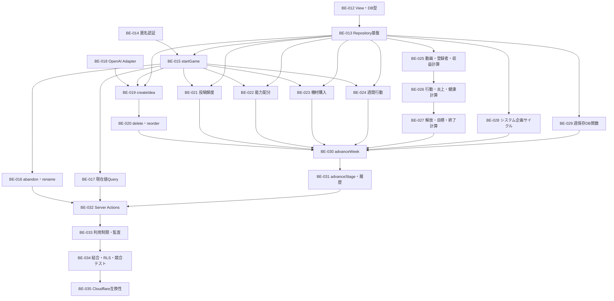

# バックエンド残チケット並列実行計画

## 1. この文書の目的

BE-000〜BE-011完了後に残るBE-012〜BE-035を、依存関係を壊さず複数のCodexセッションとworktreeで実装する順番を示す。

各チケットの仕様・受け入れ条件の正本は [BACKEND_TICKETS.md](./BACKEND_TICKETS.md) とする。この文書は実行順と合流条件だけを扱い、チケット仕様を置き換えない。

## 2. 現在地

- 完了：BE-000〜BE-011
- 次に着手可能：BE-012、BE-014、BE-018
- DB基盤、RLS、初期ルールセット、650件の企画データまで完成済み
- バックエンド完了条件：BE-035完了

## 3. 並列実装の基本ルール

1. 1チケットにつき1ブランチ・1worktreeを使用する。
2. 同じウェーブ内のチケットは、記載された開始条件を満たせば並列実装できる。
3. 後続チケットは、依存チケットが`main`へマージされ、受け入れ確認が終わってから開始する。
4. 同一ウェーブのブランチは同じ`main`から作成する。
5. 完了ブランチは1本ずつ`main`へマージし、残りのブランチは最新`main`を取り込んで再検証する。
6. 共通型、Repositoryインターフェース、DB生成型を各ブランチで独自に増やさない。共通契約は依存元チケットで確定する。
7. マージごとに最低限`lint`、`typecheck`、関連テストを実行し、ウェーブ終了時に全テストを実行する。
8. DBオブジェクトを追加する場合は、RLS、`GRANT`、`anon`・`authenticated`・`PUBLIC`の権限を必ず確認する。

## 4. 依存関係の全体像



## 5. ウェーブ別実行順

### Wave 1：今すぐ開始する3並列

開始条件：BE-000〜BE-011完了。

| 並列レーン | チケット | 内容 | 次に解放するチケット |
|---|---|---|---|
| A | BE-012 | 読み取りView・DB生成型 | BE-013 |
| B | BE-014 | Supabase匿名認証・Cookie | BE-015 |
| C | BE-018 | OpenAI企画評価Adapter | BE-019 |

3チケットは相互依存がないため、別worktreeで同時に実装できる。

注意点：

- BE-012はDB View、型生成、RLSとView権限を担当する。
- BE-014は認証・Cookie境界だけを担当し、ゲーム開始処理を先取りしない。
- BE-018はOpenAI Adapterだけを担当し、企画保存処理を先取りしない。
- BE-012が最初に終わった場合、BE-014・BE-018の完了を待たずBE-013を開始できる。

### Wave 2：Repository基盤を確定する

開始条件：BE-012が`main`へマージ済み。

| 並列レーン | チケット | 内容 |
|---|---|---|
| A | BE-013 | Repository・Mapper・トランザクション・Clock・RandomSource境界 |

BE-013は多くの後続チケットが共有する契約を作るため、同じ領域を別チケットで先行実装しない。

BE-014とBE-018が未完了なら、この期間も別レーンで継続できる。

### Wave 3：ゲーム開始と週進行基盤を4並列

開始条件：BE-013完了。BE-015だけはBE-014完了も必要。

| 並列レーン | チケット | 内容 | 開始条件 |
|---|---|---|---|
| A | BE-015 | 選択肢Query・`startGame` | BE-013、BE-014 |
| B | BE-025 | 動画再生数・登録者・収益計算 | BE-013 |
| C | BE-028 | システム企画プール・50件サイクル | BE-013 |
| D | BE-029 | `commit_advance_week` DB関数 | BE-013 |

この4チケットは責務が分かれているため、別worktreeで並列化しやすい。

レーンBは次の直列チェーンとして継続する。

```text
BE-025 → BE-026 → BE-027
```

- BE-026はBE-025の計算型・丸め規則を利用する。
- BE-027はBE-025・BE-026両方の計算結果を利用する。
- BE-025〜027を別セッションへ分ける場合も、前チケットをマージしてから次を開始する。

### Wave 4：ゲーム開始後の機能を並列実装

開始条件：BE-015完了。BE-019はBE-018完了も必要。

論理上、以下はすべて並列実装できる。

| 優先度 | チケット | 内容 | 追加依存 |
|---|---|---|---|
| P0 | BE-017 | 現在ゲーム・目標・最終結果Query | BE-012 |
| P0 | BE-019 | `createIdea` | BE-018 |
| P0 | BE-021 | `setPostingFrequency` | なし |
| P0 | BE-022 | `allocateAbilityPoints` | なし |
| P0 | BE-024 | `selectWeeklyMainAction` | なし |
| P1 | BE-016 | `abandonGame`・`renameChannel` | なし |
| P1 | BE-023 | `purchaseEquipment` | なし |

BE-019完了後は、次を開始できる。

| チケット | 内容 | 依存 |
|---|---|---|
| BE-020 | `deleteIdea`・`reorderIdeaStock` | BE-019 |

最大7並列も可能だが、Repository・エラー型・テストfixtureの競合を抑えるため、実運用では3〜4並列を推奨する。

推奨優先順：

1. BE-019、BE-021、BE-022、BE-024
2. BE-020、BE-017、BE-016、BE-023

Wave 3のBE-025〜029は、Wave 4と並行して継続できる。

### Wave 5：advanceWeek前の合流確認

BE-030を始める前に、以下がすべて`main`へマージ済みであることを確認する。

- BE-019
- BE-020
- BE-021
- BE-022
- BE-023
- BE-024
- BE-025
- BE-026
- BE-027
- BE-028
- BE-029

この時点で、企画・週間設定・計算エンジン・DB保存関数の契約を固定する。未マージブランチを直接参照してBE-030を開始しない。

### Wave 6：週進行の統合

| 順番 | チケット | 内容 | 並列可否 |
|---|---|---|---|
| 1 | BE-030 | `advanceWeek`ユースケース | 単独推奨 |
| 2 | BE-031 | `advanceStage`・週間履歴Query | BE-030後 |

BE-030は多数の機能を統合するため単独実装を推奨する。BE-016・BE-017が未完了なら、BE-030・BE-031と並行して完了させてもよいが、BE-032開始前には必ずマージする。

### Wave 7：公開境界と最終品質保証

ここからは依存が直列になるため、原則1チケットずつ進める。

| 順番 | チケット | 内容 | 開始条件 |
|---|---|---|---|
| 1 | BE-032 | Server Actions・共通エラーマッピング | BE-014〜BE-031完了 |
| 2 | BE-033 | OpenAI利用制限・監査ログ・エラー観測 | BE-032完了 |
| 3 | BE-034 | バックエンド結合・RLS・競合テスト完成 | BE-033完了 |
| 4 | BE-035 | Next.js・Cloudflare互換性確認 | BE-034完了 |

BE-034のテストは最後にまとめて作り始めるのではなく、各チケットで追加したテストを集約・補完する。

## 6. 推奨4レーン運用例

同時実行数を4セッションに抑える場合の一例を示す。矢印は同じレーンで前チケットのマージ後に次へ進むことを表す。

```text
Lane A: BE-012✅ → BE-013✅ → BE-015 ✅→ BE-019✅ → BE-020✅ 
Lane B: BE-014 ✅→ BE-025 ✅→ BE-026 ✅→ BE-027
Lane C: BE-018 ✅→ BE-028 ✅→ BE-021 ✅ → BE-022✅ 
Lane D:          BE-029✅ → BE-024✅ → BE-023 → BE-017 → BE-016

全レーン合流
  ↓
BE-030 → BE-031 → BE-032 → BE-033 → BE-034 → BE-035
```

この例は担当レーンを固定するものではない。実際の終了順に応じて、空いたレーンへ開始条件を満たしたチケットを割り当てる。

## 7. マージゲート

### Wave 1終了時

- Viewが`security_invoker = true`
- DB生成型が再生成可能
- 匿名セッションをCookieから復元可能
- OpenAI Adapterをモックへ差し替え可能

### BE-013終了時

- RepositoryとMapperの責務が固定
- DomainがSupabase SDKを直接参照しない
- Clock・RandomSourceをテストで固定可能

### Wave 4・5終了時

- 全更新ユースケースで所有者・活動状態・`expectedVersion`を検証
- 計算関数がDB・実時刻・実乱数へ非依存
- BE-029のDB関数を`authenticated`から直接実行不可
- `npm run db:test`、`npm run test`が成功

### BE-030終了時

- 正常、活動不能、致死、期限切れの全経路を処理可能
- 冪等再送と同一週二重実行を検証済み
- 週1・3・7本の代表シナリオが成功

### 最終納品時

- BE-000〜BE-035の受け入れ条件を満たす
- 空DBからマイグレーション・seed・全テストを再現可能
- 別匿名ユーザーからのアクセスを拒否
- `npm run lint`、`npm run typecheck`、`npm run build`、`npm run cf:build`が成功
- 秘密情報がクライアントバンドルやログへ混入していない

## 8. チェックリスト

### すぐ開始

- [ ] BE-012 読み取りView・DB生成型
- [ ] BE-014 Supabase匿名認証・Cookie
- [ ] BE-018 OpenAI企画評価Adapter

### 基盤合流後

- [ ] BE-013 Repository・トランザクション・時計・乱数境界
- [ ] BE-015 ゲーム開始

### ゲーム機能・計算・保存

- [ ] BE-016 中断・名前変更
- [ ] BE-017 現在状態Query
- [ ] BE-019 企画作成
- [ ] BE-020 企画削除・並べ替え
- [ ] BE-021 投稿頻度
- [ ] BE-022 能力配分
- [ ] BE-023 機材購入
- [ ] BE-024 週間行動
- [ ] BE-025 動画・登録者・収益計算
- [ ] BE-026 行動・炎上・健康計算
- [ ] BE-027 解放・目標・終了計算
- [ ] BE-028 システム企画サイクル
- [ ] BE-029 週結果保存DB関数

### 統合・公開境界

- [ ] BE-030 `advanceWeek`
- [ ] BE-031 `advanceStage`・週間履歴
- [ ] BE-032 Server Actions
- [ ] BE-033 利用制限・監査ログ
- [ ] BE-034 結合・RLS・競合テスト
- [ ] BE-035 Cloudflare互換性
